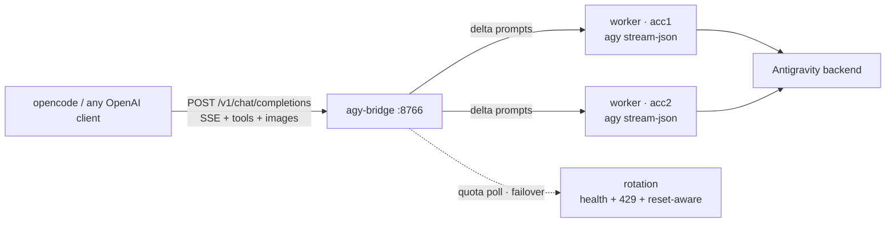

# agy-bridge

[](LICENSE)
[](https://bun.sh)
[](https://github.com/sahilwasgood/agy-bridge)
[](https://platform.openai.com/docs/api-reference/chat)

OpenAI-compatible HTTP bridge over **persistent** `agy` (Google Antigravity CLI) workers — built for agentic coding harnesses like OpenCode that need multi-turn tool use, multi-account quota rotation, and vision, without re-sending the world on every turn.



- **Persistent workers** — one long-lived `agy stream-json` process per session; deltas only, `--conversation` resume
- **Multi-account rotation** — health scores, quota-aware picks, 429 failover, works on keyring-global platforms via credential swap
- **Vision** — `image_url` (data: or http) handled natively
- **Trajectory guard** — clean error at 239k instead of silent truncation
- **Zero dependencies** — Bun + Node stdlib only, 12-test suite that spends no quota

## Why not the others

| Project | What it is | Why not enough |
|---|---|---|
| `anyrobert/agy-api-proxy` | One-shot `agy -p` per request | Full re-prefill every turn; no sessions |
| `Anubisx404/agy-plugin` | Persistent workers + deltas | Hermes-only, no HTTP endpoint |
| `lojik-ng/agy-openai-api` | Docker + vision + search | One-shot subprocesses, no pooling |
| `hrmasss/antigravity-swap` | Multi-account switching | CLI switcher, no serving layer |
| `andyvandaric/opencode-ag-auth` | OpenCode OAuth + rotation | Different architecture (direct API) |

agy-bridge takes the worker protocol from Anubisx404, the HTTP skin from anyrobert, vision via temp files from lojik-ng, health/quota rotation constants from opencode-ag-auth, and the credential-swap pattern for keyring-global platforms from antigravity-swap. MIT, like all of them — credits in code comments.

## Setup

Prereqs: [`agy` CLI](https://antigravity.google/download) logged in, [Bun](https://bun.sh) runtime.

```bash
git clone <this-repo> agy-bridge && cd agy-bridge
cp agy-bridge.example.json agy-bridge.json
# put a long random string in apiKey
bun server.js snapshot acc1        # saves CURRENT agy login into a slot
```

More accounts (each gets isolated quota + failover):

```bash
bun server.js onboard              # backs up live login, clears it
agy                                # log in as the next Google account
bun server.js snapshot acc2        # saved + quota-verified, picked up with no restart
```

One slot per login — never snapshot the same Google account twice (it would double-spend one quota thinking it's two people).

## Endpoints

- `GET /v1/models` — live catalog from `agy models` (hourly cache)
- `POST /v1/chat/completions` — streaming SSE + non-stream, `tools` via `<tool_call>` text protocol, `image_url` (data: or http) via temp files, `user` selects the session key
- `GET /v1/quotas` — per-account quota windows, health, lock state

## Opencode wiring

```jsonc
"provider": { "agy-local": {
  "npm": "@ai-sdk/openai-compatible",
  "options": { "baseURL": "http://127.0.0.1:8766/v1", "apiKey": "<yours>" },
  "models": { "gemini-3.8-flash": {
    "limit": { "context": 239000, "output": 32000 }
  } } }
}}
```
(Register one entry per effort level — e.g. `gemini-3.8-flash-low` — if you want them as separate picker models. Note: opencode ≤2.0.29 does not resolve `#variant` suffixes on custom providers, so variants are documented here for newer versions only.)

The 239k context cap is deliberate: agy checkpoints trajectories at ~239,616 tokens regardless of model window — past it, history is silently truncated. The bridge errors cleanly instead (`/compact`, then retry).

## Run it durably

```bash
# systemd user unit (see repo for agy-bridge.service example) or:
setsid bun server.js >bridge.log 2>&1 < /dev/null &
```

## Design notes

- **Keyring-global platforms** (desktop Linux/macOS/Windows): agy auth ignores `--gemini_dir`, so rotation uses credential **swap** — a slot's blob goes live only for spawn/quota-check seconds, restored in `finally` under a PID-checked file lock (self-heals stale locks, 120s cap instead of hanging forever).
- **Tool fidelity**: streamed `call_start` on name-parse, full args at block close; partial JSON is never emitted. Bare-JSON fallback requires known tool names.
- **Rotation**: health scores (70/+1/−10/−20, floor 50) + worst-family quota + LRU jitter; 429 → lock till reset + failover with full re-prefill (trajectories don't transfer across logins); ≤5s retry-after retries same account once.
- **Tests**: `bun test.js` — pure-function suite, zero quota. Live paths verified against real agy (completion, tools, image, stream, quotas).
